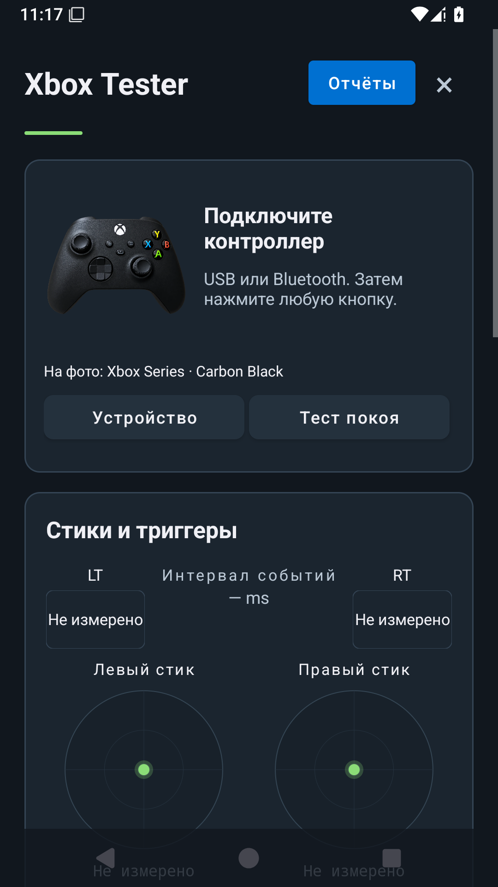
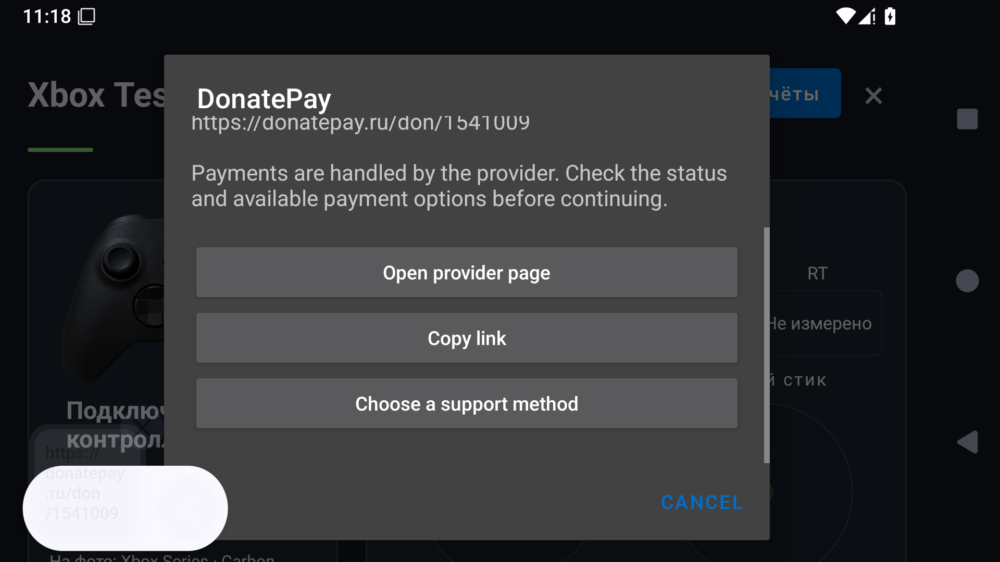

# Xbox Tester

Android diagnostic application for Xbox controller. The published debug preview is **1.2.2 / build 5**; Android 5.0+ API compatibility is declared, physical device coverage is listed separately below. Other OS packages are not provided by this repository.

[Debug APK](https://github.com/remteh-by/xbox-tester/releases/download/v1.2.2-preview.1/Xbox-Tester-1.2.2-b5-debug.apk) · [Release, SHA-256 и исходники](https://github.com/remteh-by/xbox-tester/releases/tag/v1.2.2-preview.1)

Debug APK не предназначен для обновления существующей release-установки. Оригинальный сертификат не заменялся; проверка физических контроллеров не выполнялась.

## Что изменено в 1.2.2

- Новый графитовый интерфейс: компактная карточка подключения, удобное меню отчётов и две колонки на широком экране.
- Исправлено открытие экрана: ScrollView теперь содержит один корневой элемент. Поворот не пересоздаёт активную сессию, круглые шкалы не растягиваются.
- Настоящее фото контроллера без фона; [автор, источник и лицензия](PHOTO-CREDITS.md). Фото не подменяет определение подключённого устройства.
- Триггеры без данных показывают «Не измерено», отсутствие оси — «Недоступно». Тест покоя требует подключённый контроллер.
- Добровольная [поддержка RemTeh — шесть способов](SUPPORT.md), доступная в меню и внизу экрана. Приглашение после сохранения отчёта появляется не чаще раза в 30 дней. Все проверки бесплатны; платёж проходит на стороне выбранного сервиса.

## Возможности измерений

- Исходные значения Android API сохраняются до фильтра отображения. Dead zone меняет картинку, а не результаты теста.
- Min/max, среднее и разброс не предполагают нулевой исходный диапазон. «Тест покоя» собирает отдельную выборку, пока вы не трогаете стики.
- Интервал событий показан как интервал событий, а не аппаратная задержка.
- Активный контроллер выбирается явно; другой геймпад и отключённая клавиатура не смешивают сессию.
- Вибрация проверяет доступные моторы контроллера. Телефон не подменяет отсутствующий мотор.
- История 20 сессий, комментарий мастера, экспорт JSON / печатного HTML и сравнение до/после. Отчёты остаются на устройстве; перед передачей проверьте комментарии.
- Управление кнопками, рекламным view и вибрацией очищается при уходе с экрана.

## Как измерять

1. Подключите контроллер по USB или Bluetooth и выберите «Устройство».
2. Начните новую сессию. Для центра стиков включите «Тест покоя» и отпустите стики. Нет событий — «не измерено», а не доказательство исправности.
3. Проверьте полный ход осей, кнопки и доступную вибрацию. Вывод зависит от драйвера Android и транспорта.
4. Экспортируйте JSON или HTML. HTML можно открыть в браузере и распечатать в PDF. Импорт открывает сравнение, не заменяя текущую сессию.

Приложение не пишет калибровку в прошивку, не измеряет end-to-end latency и не гарантирует поддержку адаптивных триггеров, гироскопа, парных Joy-Con или независимого управления каждым мотором, если Android не предоставляет эти функции. Названия Xbox/DualSense/Joy-Con обозначают интерфейс профиля, а не сертификацию каждого устройства.

## Build / сборка

[Build and signing instructions](docs/BUILDING.md) · [Shared diagnostics module](docs/DEVICE-LAB.md) · [Changes](CHANGELOG.md).

Use JDK 17, Android SDK 35 and the committed Gradle 8.9 wrapper. Debug builds need no release secrets. A release requires the existing private signing identity; a new debug certificate cannot update a store-installed app. CI APKs are validation artifacts, not a claim of device acceptance.

## Distribution and acceptance

See the [release list](https://github.com/remteh-by/xbox-tester/releases) for actually published files. Version 1.2.2 is distributed as a debug preview. There is no verified Google Play purchase URL in this repository; no placeholder purchase button is offered.

Current validation: shared diagnostics unit tests, Android debug build/lint, emulator startup, support dialog and rotation. Pending: launch on a physical Android device, USB and Bluetooth with Xbox controller, device switching, real vibration and update over the existing signed app. Debug installation must not replace or delete user data to work around a certificate mismatch.

## License

The existing [proprietary license](LICENSE) remains in force. Source availability does not change the licensing terms. License/purchase arrangements must be confirmed through a verified owner channel; a donation does not automatically grant a license.

## Проверка 1.2.2

Добавлен выбор шести способов поддержки с их фактическим статусом, открытием и копированием точной ссылки. Patreon исключён.

Канонический Android-адаптер сверён с выпущенным интерфейсом и общими измерениями Device Lab. SOURCE.json теперь содержит фактические хеши всех общих исходников. Версия в пакете, JSON и видимом подвале — 1.2.2 / build 5.

Сборка, Android lint и Java core tests пройдены. Обновление поверх опубликованной debug 1.2.1 проверено на SDK Android 15 с тем же сертификатом и сохранением контрольной записи private preferences. Портретный и альбомный скриншоты получены из этой сборки. Реальный контроллер в SDK не имитировался; физические оси, мотор, Bluetooth и игра требуют отдельного устройства.

[Общий просмотр отчётов Device Lab](https://remteh-by.github.io/Device-Lab/) · [Онлайн-тест геймпада](https://remteh.by/remont-gamepadov/diagnostika-gejmpada)

## Support options

[Ko-fi, Afdian, Boosty, DonationAlerts, DonatePay and OKX Pay](SUPPORT.md). Optional support; each method shows its current setup/payment-verification status.

